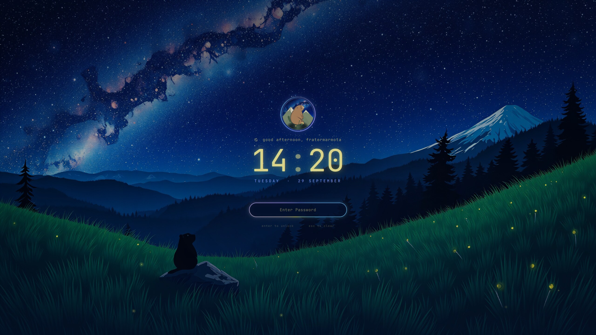

# Starwatch Lock Screen

> **Superseded.** This plugin is now [omarchy-living-lock](https://github.com/prostratepossum/omarchy-living-lock), part of [Omarchy Living Themes](https://github.com/prostratepossum/omarchy-living-themes). It has the same Starwatch scene plus Moonlit Hearth, and switches automatically with your theme. This repository is archived and gets no further updates.

Omarchy's lock screen, reskinned as a night sky.



- the wallpaper with a slow zoom (animated with the Starwatch shader on `*starwatch*` wallpapers)
- a marmot badge in a rotating ring
- a time-of-day greeting and a glowing clock
- a password pill with an aurora ring
- fireflies floating around, and sparks on every keystroke
- a red shake on a wrong password

It is a fork of Omarchy's built-in `omarchy.lock`. Authentication is unchanged: the same PAM password and fingerprint flows (`omarchy-lock-password`, `omarchy-lock-fingerprint`), with only the view restyled. Colors follow your current Omarchy theme. It looks best with the [Alpine Marmot theme](https://github.com/prostratepossum/omarchy-alpine-marmot-theme).

## Install

```bash
omarchy plugin add https://github.com/prostratepossum/omarchy-starwatch-lock --enable
```

Enabling it switches off the built-in `omarchy.lock` automatically.

## Preview without locking

```bash
omarchy-shell lock previewInteractive   # typing works, nothing is checked, closes after 90 s
omarchy-shell lock hidePreview
```

Test with the preview first. Don't lock your real session until you've seen it work.

## Remove

```bash
omarchy plugin remove io.github.prostratepossum.starwatch-lock
```

This restores the stock lock screen.

## Dependencies

None beyond Omarchy (Quickshell / Qt 6, Qt Particles).

## License

Code: MIT, derived from Omarchy's `omarchy.lock` (MIT). The badge art is for personal use only. See [LICENSE](LICENSE).
